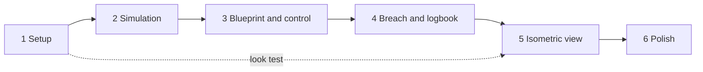

# Hey, Velora: vertical slice action plan

Based on the Codecks cards tagged `vs-MVP` (read on 2026-11-25) and the concept document. This plan covers what to build, in what order, and how to tell each part is finished. Class design comes in a later pass.

## 1. Goal

Show the core rule, **"learn is real, do is rehearsal"**, in a few minutes with as little content as possible.

| Content | Slice |
|---|---|
| Space | One private room, one hallway, one lounge, single floor |
| Residents | R5 |
| Time | 06:00 to 08:00 |
| Event | R5 types a laptop password in the lounge |
| Reveal (eye) | Access common-area cameras |
| Change (hand) | Lock / unlock R5's door |

### Player experience

| Loop | Player | Result |
|---|---|---|
| 1 | Watches the blueprint | A blip reaches the lounge. The log gets the location from sensors, but what R5 did there is a gap |
| 1 | Accesses the cameras | Hallway and lounge become isometric, for good. The eye greys out. The log gets a breach mark |
| 2 | Watches again | The log fills the gap: R5 types a password |
| 3 | Locks R5's door | R5 can't leave, and the event never happens. Velora still knows the password |
| 4 | Does nothing | The door is unlocked again. The breach and log remain |

The loop numbers are only the expected path. If the player breaches after 07:15, the password has to wait for the next loop. If they breach before it, loop 1 is enough.

### Out of scope

Lights, heating, stairs, elevators, other residents, automations, leads, cause-effect chains, divergence flags, voice commands, other breach levels, the live run and endings.

The slice does not use the password for anything. Its job is to show that knowledge survives the reset.

## 2. Reference numbers

Starting values. Keep them in data so they can be tuned.

### Time

| Value | Setting |
|---|---|
| 1x speed | 1 real second = 1 game minute |
| Slice loop at 1x | 2 real minutes |
| Sim tick | 6 game seconds, so 10 ticks per real second at 1x |
| Ticks per slice loop | 1,200 |
| Speeds | Pause, 1x, 2x, 4x, 8x |

At this scale, 18 hours last 18 real minutes, within the concept's 15–20. The end of the day should be a setting: 08:00 in the slice, midnight later.

### Walking

A realistic pace would be about 84 m per game minute, so R5 would cross the floor in a blink. Use **2 m per game minute** (0.2 m per tick), which looks like a brisk walk at 1x. Trips then cost noticeable game time, and timetables must allow for it.

### Space

| Area | Size | Notes |
|---|---|---|
| R5's room | 4 × 4 m | Private. Lockable door with a sensor |
| Hallway | 12 × 2 m | Common. Camera |
| Lounge | 6 × 6 m | Common. Camera, open entrance with a sensor |

R5's route: desk → room side of door (3 m) → hallway side (1 m) → hallway at lounge (8 m) → lounge entrance (1 m) → seat (3 m). That is 16 m, or 8 game minutes.

### R5's untouched day

| Time | Where | Activity | Sensors know | Cameras add |
|---|---|---|---|---|
| 06:00–06:50 | Room | Sleeps | In room | – |
| 06:50–07:02 | Room | Gets ready | In room | – |
| 07:02–07:10 | Hallway | Walks to lounge | Left room, entered lounge | Seen walking |
| 07:10–07:15 | Lounge | Sits down | In lounge | Sitting |
| **07:15** | Lounge | **Types password** | Nothing | **The event** |
| 07:15–07:45 | Lounge | Works on laptop | In lounge | Working |
| 07:45–07:53 | Hallway | Walks back | Left lounge, entered room | Seen walking |
| 07:53–08:00 | Room | Rests | In room | – |

## 3. Rules to fix before building

Each one affects several cards. These are recommended answers; change any of them now rather than later.

### Simulation

1. **The simulation is data that advances by ticks, and the visuals only display it.** Nothing visual (animation, physics, frame time) may feed back into it.
2. **No randomness.** The slice doesn't need it. If it is added later, it must be seeded.
3. **No NavMesh.** R5 follows a few waypoints, with the door between two of them. The result is exact and repeatable.
4. **Reset restores the 06:00 state instead of reloading the level.** Everything belongs to one of two groups:

| Reset every loop | Survives every loop |
|---|---|
| Clock | Breaches |
| R5's position, activity and timetable progress | Logbook |
| Door lock | Known facts (the password) |
| Events that happened this loop | Loop number |
| Current selection | |

A new piece of state should not be added without deciding its column.

### Door

5. R5 only discovers a lock **on reaching the door**.
6. Someone already passing through finishes crossing.
7. While blocked, R5 waits and leaves as soon as the door unlocks.
8. R5 gives up on the lounge at **07:40** and stays in the room.
9. The password is typed **5 minutes after reaching the lounge**, so a late unlock shifts the event instead of cancelling it.

| Player does | Expected result |
|---|---|
| Nothing | Password at 07:15 |
| Locks before 07:02 and leaves it | No event |
| Locks before 07:02, unlocks at 07:20 | Password at about 07:32 (13 m left from the door = 6.5 min, plus 5) |
| Locks while R5 is in the lounge | R5 returns, waits in the hallway until the loop ends |

This table is the slice's version of "every change ripples", and it doubles as the test list for $17u.

### Knowledge

10. **Sensor information is always logged.** It covers door crossings and which room R5 is in.
11. **View information is logged only where cameras are breached.** It covers activities and the password. The whole floor fits on screen, so a breached room counts as watched.
12. **Better knowledge never gets overwritten by worse.** A timetable slot goes from *unseen* to *located* to *known*, never back.
13. **The routine only fills from untouched time.** After a hand action, the rest of that loop stops feeding the routine, or a locked-in R5 would be logged as normal behaviour. Facts such as the password are still recorded.
14. **The private room stays at sensor level.** Before and after the breach it shows its outline and R5's blip. It must not show less after the breach than before.
15. **The cameras are one breach**, available from the hallway or the lounge.

### Loop flow

16. At 08:00, or on manual restart, the loop counter goes up and the day returns to 06:00 **paused**, so the player can plan.

## 4. Card map

| Card | In the slice |
|---|---|
| $18e Create Unreal project | Done |
| $18f Version control | Marked done, but LFS is missing (step 1) and the text still mentions Unity |
| $18g Render pipeline | Archived. The remaining settings are in step 1 |
| $18h Input | Full, including pause and speed hotkeys |
| $18j Determinism | Answered by rules 1–3, proven in step 2 |
| $18k Reset method | Answered by rule 4 |
| $18o Navigation | Answered by rule 3 |
| $18i Greybox assets | Three rooms, a little furniture, one resident |
| $18u Cast and secrets | R5 only |
| $18v Timetables | R5 only (section 2) |
| $17k Day clock | Full, with a configurable end time |
| $17q Loop reset | Full |
| $17r Routine scheduler | One timetable, read from data |
| $17s Pathing | One floor, one lockable door |
| $17u Reactions and ripples | Locked door only |
| $17v Eye and hand tags | Full. No slice action uses both tags |
| $17w Breach store | Full, one breach |
| $17y Routine auto-fill | R5 only, with gaps |
| $185 Device control | Door lock only |
| $186 Selection | Full: rooms, door, R5 |
| $188 Views | Full, one direction (blueprint to isometric) |
| $193 Blueprint visuals | Full |
| $195 Icons and action UI | Full, including greyed-out state |
| $17f $17g $17h $17i | Hero cards, closed when their slice parts are |

Two untagged cards overlap with the slice. $17o (time controls) is needed for the $18h hotkeys to do anything, and the darkness in $188 is a small part of $17x (fog of war). Consider tagging $17o.

## 5. Build order

Sizes are relative: S, M, L.

### Step 1: Setup (S)

Cards: $18f gap, $18h, what is left of $18g

- [ ] Add Git LFS rules in `.gitattributes` for `.uasset`, `.umap` and source art, **before committing any asset**.
- [ ] Create the content folder structure.
- [ ] Create an empty, non-World-Partition project map and make it the default for game and editor. It is currently the engine's OpenWorld template.
- [ ] Set up input: select, pause, the four speeds, restart.
- [ ] Set mouse behaviour for a pointer-driven game: visible cursor, no permanent capture.
- [ ] Use fixed exposure, so dark rooms stay dark.
- [ ] Decide whether hardware ray tracing and Substrate stay on. Both are enabled now, and the slice doesn't need either.
- [ ] **Look test:** two boxes, one lit and one dark, under an isometric camera. Compare orthographic with a narrow-FOV perspective and pick one. Try Lumen with both.

**Done when** a fresh clone opens on the project map, every input produces a visible debug response, and a camera type is chosen.

### Step 2: Simulation (L)

Cards: $18j, $18k, $18o, $17k, $17q, $17r, $17s, $17u, with $18v as input

No finished visuals. Debug text and shapes are enough.

- [ ] **Clock ($17k):** accumulate real time × speed, run whole ticks, keep the remainder. After a hitch, spread the catch-up over several frames and never skip ticks.
- [ ] **Speeds:** change how many ticks run, never what a tick does.
- [ ] **Layout data:** rooms, waypoints, door, sensors, cameras, and whether each room is private or common. The simulation, blueprint and greybox all read it.
- [ ] **Timetable ($17r):** R5's day loaded from data. Tell apart fixed times (leave at 07:02) and durations (type after 5 min), because rule 9 depends on it.
- [ ] **Movement ($17s):** advance along the waypoints per tick.
- [ ] **Door ($17s, $17u):** rules 5–9.
- [ ] **Event list:** room exits and entries, activity changes, lock changes, the password. Each has a tick. The logbook will read this in step 4.
- [ ] **Reset ($17q):** restore the first column of rule 4.
- [ ] **Repeat test ($18j):** run two untouched days, and one at 8x, and compare their event lists. Make it an automated test if possible.

**Done when**
- the three event lists match exactly, and a low frame rate doesn't change them;
- all four rows of the door table give the expected result;
- a reset after any of those rows gives back the untouched day.

**Watch for:** time from frame delta reaching the simulation, an update order that depends on spawn order, and timers that keep running through a reset.

### Step 3: Blueprint and control (M)

Cards: $193, $186, $185, $17v, $195 first pass

- [ ] **Floor plan ($193):** outlines, door, sensors and room labels drawn from the layout data.
- [ ] **Blip:** R5's position, smoothed between ticks. It shows location only, never activity.
- [ ] **HUD:** clock, loop number, speed buttons with the active one highlighted.
- [ ] **Selection ($186):** hover and selected states for rooms, door and R5. Clicking empty space clears it.
- [ ] **Action panel ($195):** lists the selected thing's actions. R5 and the private room have none, so design that empty state.
- [ ] **Tags ($17v):** every action carries eye, hand or both in its data. The icon comes from the data, not from each button.
- [ ] **Lock ($185):** toggle, with a visible door state. It must also work while paused.
- [ ] **Loop end:** a short transition to the next loop, then paused at 06:00.

**Done when** someone who hasn't seen the game can, with no debug tools, watch a loop, lock the door, and tell you that R5 didn't leave because of it.

**Watch for:** the UI reading the simulation directly. Send it through one place that answers "what may Velora show?", because step 4 changes the answer.

### Step 4: Breach and logbook (M)

Cards: $17w, $17y, $195 greyed state

- [ ] **Camera action:** eye-tagged, available on hallway and lounge. It changes nothing in R5's day.
- [ ] **Breach store ($17w):** recorded once, kept through resets, saved to disk immediately so quitting can't undo it.
- [ ] **Greyed eye ($195):** stays visible and can't be used again. It should read as "already known", not as disabled.
- [ ] **Visibility:** apply rules 10, 11 and 14 in the single place from step 3.
- [ ] **Routine strip ($17y):** 06:00 to 08:00 with three looks: unseen, located, known. The gap in the lounge has to be noticeable.
- [ ] **Log entries:** text for sensor entries, the password and the breach mark. Plain placeholders first, Velora's cold voice later.
- [ ] **Merge rules:** rules 12 and 13.
- [ ] **Debug wipe:** clear the save. Needed constantly for testing and demos.

**Done when**
- loop 1 without a breach leaves the lounge gap, and a later loop with it fills the gap;
- breaching after 07:15 does not reveal that loop's password;
- a first loop played with the door locked does not log "stays in room" as R5's routine;
- breach, log and grey eye survive a reset and an editor restart.

### Step 5: Isometric view (L)

Cards: $18i, $188

- [ ] **Greybox ($18i):** three rooms, seat, laptop, desk, bed, R5. Build them to the layout data's measurements so blip and body match.
- [ ] **View state per room:** blueprint or isometric. Giving each room two sets of visuals and switching between them is simpler than one material that does both looks.
- [ ] **Camera move:** top-down to isometric when the breach happens, in the same scene.
- [ ] **Private room:** dark, with outline, blip and a "protected" label.
- [ ] **R5:** body in breached rooms, blip in the private one. Check the swap at the doorway.
- [ ] **Activities:** walk, sit and type need to be told apart. Poses are enough.
- [ ] **Walls:** cut away or low, so nothing hides R5 or blocks clicks.
- [ ] **Selection** works the same in both views.
- [ ] **Loading:** if the breach is already saved, start in isometric with no transition.

**Done when** the whole player experience in section 1 works without debug tools, and nothing inside the private room is visible at any point.

### Step 6: Polish (M, scale to the time left)

In priority order:

1. **The breach moment.** The concept calls for a distinct visual that breaks the frame, and for trailers to build to it. It should feel different from every other click.
2. **Logbook writing** in Velora's voice.
3. **The loop transition.**
4. **Sound:** soft chimes, door sensor, lock, quiet room tone.
5. **Final blueprint look and icons.**

**Done when** a first-time player finishes the slice and can say, unprompted, that the lock was undone but the breach wasn't.

## 6. Parallel work

| Work | Needed by |
|---|---|
| R5: who they are, why the password matters, weak point ($18u) | Step 4 text |
| Final R5 timings ($18v) | Step 2 |
| Eye and hand icons ($195) | Step 3 (placeholders work) |
| Blueprint style sheet: lines, colours, blip ($193) | Step 3 |
| Greybox kit ($18i) | Step 5 |

## 7. Risks

| Risk | Early sign | Response |
|---|---|---|
| Two minutes feels empty | Players go straight to 8x | Shorten the window or move the event earlier before adding content |
| The lounge gap isn't noticed | Players don't wonder what R5 did | Make the gap louder in the routine strip |
| The breach feels like a normal button | No hesitation, no reaction | Spend step 6 on item 1 only |
| The chosen camera looks wrong with Lumen | Look test in step 1 | Switch camera type, or use simple dynamic lights |
| Scope grows | New rooms or actions before step 5 | Finish section 1 first |

## 8. If there is time left

1. A second resident whose morning depends on R5 arriving, so the lock ripples to someone else.
2. Something that uses the password.
3. One "Hey, Velora" request with obey, ignore and reinterpret.

## 9. For the class design pass

1. Where the simulation lives in Unreal, and who ticks it.
2. How the two groups in rule 4 are represented.
3. Data format for layout, timetable and actions.
4. How events reach the logbook.
5. The "what may Velora show?" layer between simulation and UI.
6. How actions are described, so tags, availability and effect stay together.
7. How rooms switch between their two looks.
8. What is saved, and when.
