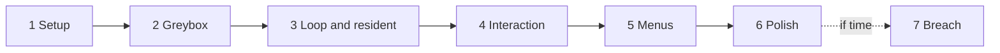

# Hey, Velora: vertical slice action plan

What to build, in what order, and how to tell each part is finished. Replaces the earlier plan based on the `vs-MVP` Codecks cards, which is still in git history.

## 1. Goal

A small, complete, playable loop in isometric view: the player watches a resident's day, changes one thing, sees the day turn out differently, and sees the change undone by the next loop.

| Content | Slice |
|---|---|
| View | Isometric from the start, orthographic |
| Space | Locked room, maintenance closet, micro hall, common area. Single floor |
| Residents | One, placeholder |
| Time | 06:00 to 08:00, 2 real minutes at 1x |
| Interactable | The lock on the resident's door |
| Menus | Main menu and pause menu, rough |

### Player experience

| Loop | Player | Result |
|---|---|---|
| 1 | Watches | The resident leaves the locked room, uses the common area and goes back |
| 2 | Locks the door | The resident never comes out |
| 3 | Does nothing | The door is unlocked again and the day goes as in loop 1 |

### Out of scope

Blueprint view, logbook, saving, a second resident, stairs, lights, heating, automations, voice commands, the live run and endings.

A breach that opens the locked room is optional (step 7). Without it, the slice shows "do is rehearsal" but not "learn is real".

## 2. Reference numbers

Starting values. Keep them in data so they can be tuned.

### Time

| Value | Setting |
|---|---|
| 1x speed | 1 real second = 1 game minute |
| Loop at 1x | 2 real minutes, as a maximum |
| Sim tick | 6 game seconds, so 10 ticks per real second at 1x |
| Ticks per loop | 1,200 |
| Speeds | Pause, 1x, 2x, 4x, 8x |
| Walking | 2 m per game minute (0.2 m per tick) |

### Space

| Area | Size | Notes |
|---|---|---|
| Locked room | 4 × 4 m | The resident's. Interior never shown. Lockable door |
| Maintenance closet | 2 × 3 m | Visible. Set dressing for now |
| Micro hall | 4 × 2 m | Joins all the other spaces |
| Common area | 6 × 6 m | Visible. Open entrance |

Route: spot in room → room side of door (3 m) → hall side (1 m) → hall at common area (3 m) → entrance (1 m) → seat (3 m). That is 11 m, or 5.5 game minutes.

### The untouched day

The player can't see into the locked room, so time spent there is kept short.

| Time | Where | Activity | Visible |
|---|---|---|---|
| 06:00–06:20 | Locked room | Gets ready | No |
| 06:20–06:25:30 | Room, hall, common area | Walks to the seat | From the door on |
| 06:25:30–07:40 | Common area | Sits | Yes |
| 07:40–07:45:30 | Common area, hall, room | Walks back | Until the door |
| 07:45:30–08:00 | Locked room | Rests | No |

## 3. Rules

### Simulation

1. **The simulation is data that advances by ticks, and the visuals only display it.** Nothing visual (animation, physics, frame time) may feed back into it.
2. **No randomness.**
3. **No NavMesh.** The resident follows a few waypoints, with the door between two of them.
4. **Reset restores the 06:00 state instead of reloading the level.** A new piece of state should not be added without deciding its column.

| Reset every loop | Survives every loop |
|---|---|
| Clock | Loop number |
| Resident's position, activity and timetable progress | Opened rooms, if the breach is built |
| Door lock | |
| Current selection | |

### Door

5. The resident only discovers a lock **on reaching the door**.
6. Someone already passing through finishes crossing.
7. While blocked, the resident waits and moves on as soon as the door unlocks.
8. The resident gives up on going out at **07:20** and stays in the room.

| Player does | Expected result |
|---|---|
| Nothing | Seated at 06:25:30, back in the room at 07:45:30 |
| Locks before 06:21:30 and leaves it | Never comes out |
| Locks before 06:21:30, unlocks at 06:40 | Seated at 06:44 (8 m left from the door) |
| Locks while the resident is in the common area | Returns at 07:40, waits in the hall from 07:43:30 until the loop ends |

This table doubles as the test list.

### View and flow

9. **The interior of the locked room is never shown.** The resident appears and disappears at its doorway.
10. **The door's lock state is always visible from the hall**, and so is a resident blocked by it. From inside, a knock or a shake of the door is enough.
11. Whether a room is visible is one value per room, read by everything that displays it, so a breach only has to flip it.
12. At 08:00, or on manual restart, the loop number goes up and the day returns to 06:00 **paused**.
13. **Time pause and the pause menu are different things.** Time pause stops the clock and still allows interaction. The menu blocks the whole game and leaves the time setting as it was.

## 4. Build order

Sizes are relative: S, M, L.

### Step 1: Setup (S)

- [x] Git LFS rules.
- [x] Project map, set as default for game and editor.
- [x] Mouse behaviour: visible cursor, no permanent capture.
- [x] Camera: orthographic, active on play.
- [x] Input actions and their bindings in the controller.
- [x] Create and commit `IMC_Inputs`, which the controller Blueprint references. Each action should fire once per press.
- [x] Fixed exposure, so dark areas stay dark.
- [x] Decide whether hardware ray tracing and Substrate stay on. The slice needs neither.

**Done when** a fresh clone opens on the project map and every input prints its debug message once per press.

### Step 2: Greybox (S)

- [ ] The four spaces at the sizes in section 2, with low or cut-away walls.
- [ ] Door, seat, a few closet props, and a capsule for the resident.
- [ ] Locked room: closed off and dark, with a "needs breach" label.
- [ ] Frame the camera so the whole floor fits on screen.

**Done when** the space reads clearly in one still frame: which room is locked, where its door is, and where the common area is.

### Step 3: Loop and resident (M)

- [ ] **Clock:** accumulate real time × speed, run whole ticks, keep the remainder. After a hitch, spread the catch-up over several frames and never skip ticks.
- [ ] **Speeds:** change how many ticks run, never what a tick does. Replace the debug prints.
- [ ] **Layout and timetable** loaded from data.
- [ ] **Movement:** advance along the waypoints per tick. The capsule is smoothed between ticks.
- [ ] **Door:** rules 5–8, with a debug toggle until step 4.
- [ ] **Reset:** rules 4 and 12.
- [ ] **Repeat test:** log what happens in two untouched days, and in one at 8x, and compare them.

**Done when**
- the three logs match, and a low frame rate doesn't change them;
- all four rows of the door table give the expected result;
- a reset after any of them gives back the untouched day.

**Watch for:** frame time reaching the simulation, an update order that depends on spawn order, and timers that keep running through a reset.

### Step 4: Interaction (M)

- [ ] **Selection:** hover and selected states for the door. Clicking empty space clears it.
- [ ] **Locked room:** can be selected, and says that it needs a breach. Its only purpose for now is to set up the idea.
- [ ] **Action:** Lock / Unlock on the door. Works while time is paused.
- [ ] **Feedback:** rule 10.
- [ ] **HUD:** clock, loop number, speed buttons with the active one highlighted.

**Done when** someone new can watch a loop, lock the door, and tell you that the resident didn't come out because of it.

### Step 5: Menus (S)

- [ ] **Main menu**, in its own map: Play, Quit. It becomes the game's default map. The editor keeps opening on the slice.
- [ ] **Pause menu:** Resume, Restart loop, Main menu.
- [ ] **Menu key:** Esc in a build, plus another key for testing, because Esc stops Play In Editor. The action has to work while the game is paused.
- [ ] Check that simulation ticks stop while the menu is open.

**Done when** the game can be started, paused, restarted and quit in a packaged build without the console.

### Step 6: Polish (M, scale to the time left)

1. Loop transition.
2. Lock feedback.
3. Sound: chime, lock, quiet room tone.
4. Lighting and materials.

**Done when** a first-time player can say, unprompted, that the lock was undone by the loop.

### Step 7: Breach (optional)

- [ ] An action on the locked room that opens its view for good. It changes nothing in the resident's day.
- [ ] The room stays open through resets (rule 11).
- [ ] The action greys out, reading as "already known" and not as disabled.
- [ ] A distinct visual moment that feels different from other clicks.

**Done when** a first-time player can say that the lock was undone but the breach wasn't.

## 5. Codecks cards

| Cards | In this slice |
|---|---|
| $18e $18f $18g $18h | Setup, step 1 |
| $18i Greybox assets | Step 2 |
| $18j $18k $18o | Answered by rules 1–4, proven in step 3 |
| $17k $17q $17r $17s $17u | Step 3, one resident and one door |
| $17o Time controls | Steps 3 and 4. Not tagged `vs-MVP` |
| $185 $186 $195 | Step 4, door lock only |
| $18u $18v | Placeholder resident and timetable only |
| $17w Breach store | Step 7, optional, without saving |
| $17v $17y $188 $193 | Deferred |

The main menu and pause menu have no card in this list.

## 6. Risks

| Risk | Early sign | Response |
|---|---|---|
| Two minutes feels empty | Players go straight to 8x | Shorten the loop or the sitting time before adding content |
| Locking has no visible effect | Players don't notice the resident is missing | Make rule 10 louder |
| Menus eat the time | Styling before step 4 is done | Default widgets only until step 6 |
| Scope grows | New rooms or actions before step 5 | Finish section 1 first |

## 7. Project structure

**Don't create a file before its step.** Details of each class are settled when its step starts.

Files live in domain folders under `Source/HeyVelora/`, with the `.h` and `.cpp` side by side. File names drop the class prefix: `AVeloraDoor` is in `VeloraDoor.h` and `VeloraDoor.cpp`. Includes start from the module root (`#include "World/VeloraDoor.h"`).

| Folder | Class | Kind | Job | Step |
|---|---|---|---|---|
| `Game/` | `AVeloraGameMode` | `AGameModeBase` | Chooses the game's classes | 1 |
| `Player/` | `AVeloraPlayerController` | `APlayerController` | Turns input into requests | 1 |
| `Data/` | `UVeloraLayoutData` | `UDataAsset` | Waypoints and door | 3 |
| `Data/` | `UVeloraTimetableData` | `UDataAsset` | One resident's day | 3 |
| `Simulation/` | Enums and small structs | `VeloraSimTypes.h` | Ids, activities | 3 |
| `Simulation/` | `FVeloraSimState` | Struct | Everything that resets | 3 |
| `Simulation/` | `FVeloraSimulation` | Plain C++ | Advances one tick, applies requests, resets | 3 |
| `Simulation/` | `UVeloraSimSubsystem` | `UTickableWorldSubsystem` | Owns the simulation, loop number, time pause and speed. Turns frame time into ticks | 3 |
| `World/` | `AVeloraResident` | `AActor` | Displays the resident | 3 |
| `World/` | `AVeloraDoor` | `AActor` | Displays the door | 3 |
| `World/` | `AVeloraRoom` | `AActor` | Room label and whether it is visible | 4 |
| `World/` | `IVeloraSelectable` | Interface | Anything that can be clicked | 4 |
| `Player/` | `UVeloraSelectionComponent` | `UActorComponent` | Hover and selection | 4 |
| `UI/` | `UVeloraHudWidget` | `UUserWidget` | Clock, loop, speeds, action | 4 |
| `UI/` | `UVeloraMainMenuWidget` | `UUserWidget` | Main menu | 5 |
| `UI/` | `UVeloraPauseMenuWidget` | `UUserWidget` | Pause menu | 5 |

### Who may include whom

- **`Simulation/` and `Data/`** know nothing about the other folders. That keeps the simulation testable and deterministic.
- **`World/` and `UI/`** read from `UVeloraSimSubsystem` and never change the simulation's state.
- **`Player/` and `UI/`** send requests to `UVeloraSimSubsystem`.

### Content folders

| Folder | Contents |
|---|---|
| `Content/Blueprints/` | Blueprint children of the C++ classes (`BP_`) |
| `Content/Data/` | Layout and timetable assets (`DA_`) |
| `Content/Inputs/` | Actions (`IA_`) and mapping context (`IMC_`) |
| `Content/UI/` | Widgets (`WBP_`) |
| `Content/Greybox/` | Placeholder meshes and materials |
